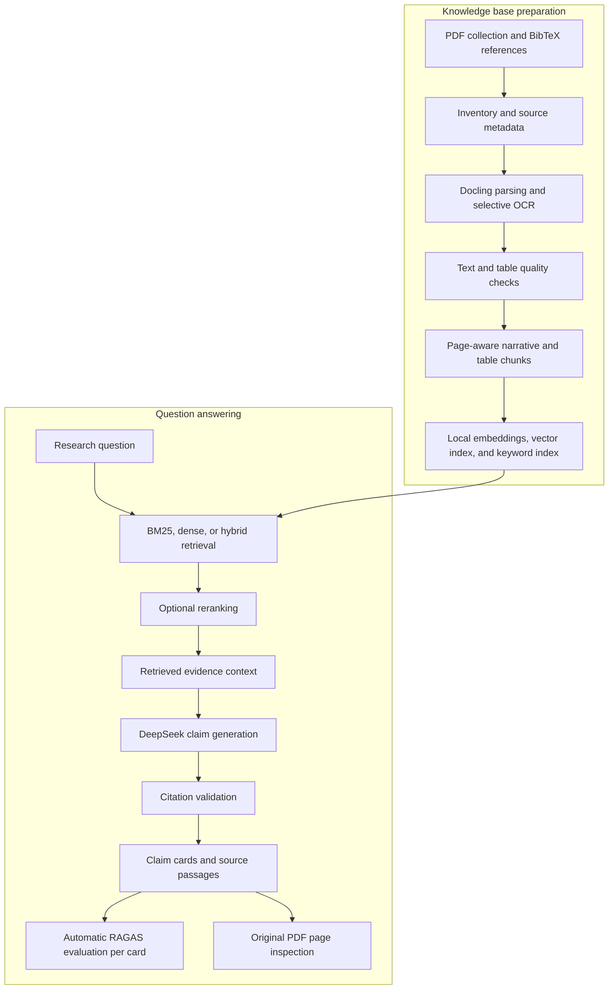

# Evidence-Based Research Assistant

A research assistant that answers questions about scientific literature using a local
knowledge base, with citations that lead back to the source passage and PDF page.

Built for literature reviews and thesis research, the application combines local
retrieval with API-based answer generation and evaluation. Each answer is presented
as individual claim cards, with supporting evidence and automatic RAGAS scores.

## Use cases

- Find the methods, datasets, metrics, and results reported in a paper.
- Compare findings across references and inspect the evidence behind each claim.
- Ask questions in Indonesian or English about a personal research collection.
- Open cited passages and original PDF pages while reviewing an answer.

## Goals

1. Ground answers in retrieved evidence from the selected knowledge base.
2. Make each claim traceable to a document, passage, and original PDF page.
3. Preserve table context and exclude ambiguous extractions before indexing.
4. Measure retrieval and answer quality while keeping model scores distinct from human validation.
5. Keep runs reproducible through source hashes, model revisions, configuration snapshots, and cached responses.

## Technology and models

| Component | Technology or model | Role |
|---|---|---|
| Application | Python 3.11+, Streamlit | Local research interface, claim cards, PDF inspection, and token usage |
| Reference import | BibTeX, `bibtexparser` | Import and audit Mendeley reference exports |
| Document parsing | Docling 2.151.1, Heron, TableFormer accurate | Extract document layout, narrative text, and structured tables |
| OCR | EasyOCR, Indonesian and English | Extract text from scanned regions |
| PDF utilities | PyMuPDF | Read native text, render source pages, and provide the baseline parser |
| Embeddings | `BAAI/bge-base-en-v1.5`, Sentence Transformers, PyTorch | Encode document chunks and questions locally |
| Search and storage | LanceDB, SQLite FTS5, SQLite | Vector search, keyword search, corpus metadata, claims, and citations |
| Retrieval fusion | Reciprocal Rank Fusion (RRF) | Combine keyword and dense retrieval rankings |
| Optional reranking | `BAAI/bge-reranker-base` | Reorder retrieved candidates against the question |
| Answer generation | DeepSeek Flash, non-thinking mode | Generate structured claims from retrieved context |
| Answer evaluation | RAGAS 0.4.4, GPT-4o-mini via Surplus | Evaluate faithfulness and response relevancy for each claim card |
| Optional diagnostics | `lytang/MiniCheck-Flan-T5-Large` | Check support for individual claim-citation pairs locally |
| Configuration and checks | YAML, pytest, Ruff | Validate settings, test behavior, and enforce code quality |

The default retrieval mode is **hybrid**. BM25, dense, and hybrid with reranking
are also available in the interface. Embedding and reranker revisions are pinned
in the [active configuration](configs/skripsi-local.yaml). The evaluator model is
resolved through `GPT_MODEL_ID`; the current setup uses `gpt-4o-mini`.

Docling and RAGAS run in separate environments with their own
[Docling](eval/docling-requirements.lock) and [RAGAS](eval/ragas-requirements.lock)
lockfiles. JEV 1.14 remains an experimental verifier and is outside the default UI flow.

## Processing flow

Document preparation happens before questions are submitted. The query pipeline
reads an existing knowledge base; it does not search the web for answer content.



Preparation records source hashes, license labels, and original page numbers.
Quality checks exclude ambiguous extractions before indexing. Table chunks preserve
captions, headers, row labels, and notes; token limits are checked before embedding.

The generator receives only the question and retrieved evidence. Citation validation
requires each cited chunk to belong to the corpus and supplied context. Claims without
valid citations are labeled as lacking evidence. RAGAS evaluates each card separately.

## Evaluation and traceability

- **Faithfulness** estimates whether the card's claim is supported by the retrieved context.
- **Response Relevancy** estimates how closely the claim relates to the question, using GPT-generated questions and local BGE embeddings.
- **Context Recall** is available in batch evaluation when a reference answer exists.

Scores are model estimates, not proof of factual correctness or citation accuracy.
A card may answer only part of a question. Faithfulness uses the full generation
context, including passages the card does not cite. MiniCheck is an optional diagnostic.

The application records token usage, API calls, and cache hits separately for the
generator and evaluator. Missing usage and failed scores remain explicitly unavailable.
New queries and diagnostics use separate database copies, preserving the source snapshot.

## Current knowledge base

The local collection contains **41 registered PDFs across 746 pages**, with
**40 searchable documents and 2,514 indexed chunks**. One scanned PDF has no chunks
that pass quality checks; three text files lack PDF page mappings and are not indexed.

Source and license status remain visible, including unverified user-provided sources.
The collection is not presented as entirely open access. PDFs, extracted text, model
files, indexes, and API caches are excluded from this repository.

## Run locally

The launch command assumes the Python environments, model files, and local knowledge
base have already been prepared. Cloning this repository alone does not provide them.
The default configuration points to local corpus snapshots.

Set provider credentials through environment variables or a local `.env` file using
[.env.example](.env.example). The current setup uses `DEEPSEEK_API_KEY` for generation
and `SURPLUS_API_KEY`, `SURPLUS_API_URL`, and `GPT_MODEL_ID` for evaluation.

From the repository root on Windows:

```powershell
.venv/Scripts/python.exe -m streamlit run src/rag/ui/app.py --server.address 127.0.0.1
```

Open [localhost:8501](http://127.0.0.1:8501), select a corpus, and submit a question.
The default corpus is configured in [skripsi-local.yaml](configs/skripsi-local.yaml).
Saved examples reuse existing answers and automatically evaluate their claim cards.

The UI uses paid APIs automatically when the required response is not cached.
Questions, claims, and retrieved context may be sent to the configured providers.
Generation is limited to two requests per submission, including format correction;
evaluation is limited to five requests per card with 1,024 output tokens per request.
Opening a citation or PDF does not repeat evaluation within the same answer session.
CLI commands remain cache-only unless API access is explicitly enabled.

The existing CUDA environment uses a manually installed PyTorch build. Do not run
`uv sync` or `uv run` against that environment until its CUDA source and lockfile
have been reconciled.

## Development and validation

Runtime dependencies are declared in [pyproject.toml](pyproject.toml). Run checks
from the repository root:

```powershell
.venv/Scripts/python.exe -m pytest -q
.venv/Scripts/python.exe -m ruff check .
.venv/Scripts/python.exe -m ruff format --check .
```

Recorded validation on November 22, 2026: **598 main-suite tests** and **15 isolated
RAGAS adapter tests** passed. One optional RAGAS module is skipped in the main
environment. Tests use mocked providers. Three saved cards were also evaluated
through the real API and replayed from cache; human accuracy has not been established.

A separate four-paper MVP benchmark is retained in the
[M6 evaluation results](eval/results/2026-11-19T01-25-11Z_7492c6/metrics.json).
Its results do not establish accuracy on the full research collection. Multilingual
retrieval, complex tables, and general answer quality still require broader validation.
