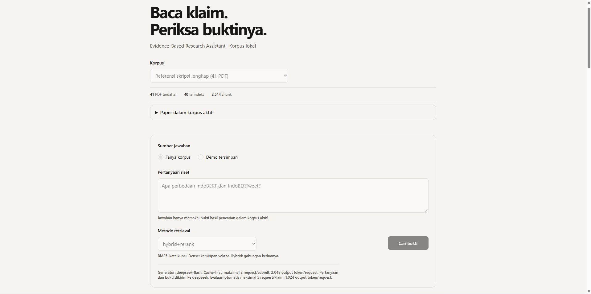
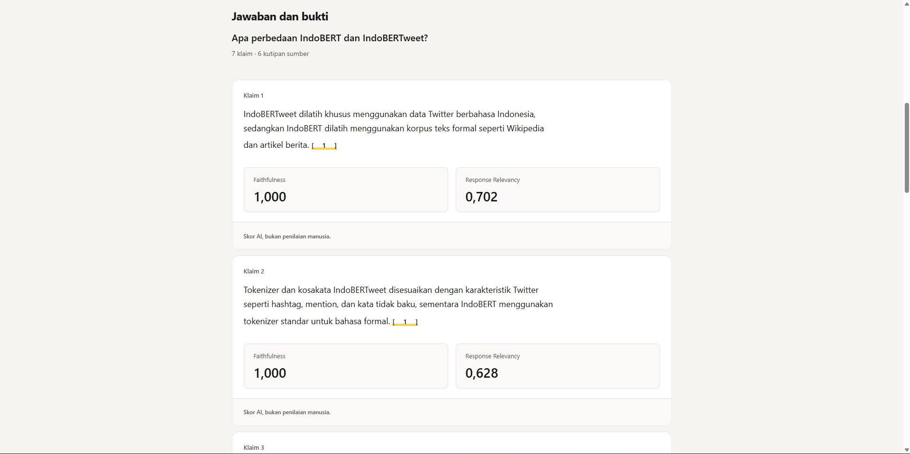
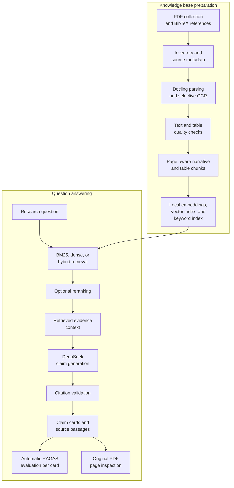

# Evidence-Based Research Assistant

A personal research tool built to support my undergraduate thesis and literature
review. It helps me search my reference collection, compare findings, and trace
answers back to the original passages and PDF pages.

The application combines local retrieval with API-based generation and evaluation.
Answers appear as claim cards with supporting evidence and automatic RAGAS scores,
helping me review the literature while keeping research decisions in my hands.

## UI screenshots

Research question form and retrieval options:



Answer cards with citations and evaluation scores:



## Use cases

- Find the methods, datasets, metrics, and results reported in a paper.
- Compare findings across references and inspect the evidence behind each claim.
- Ask questions in Indonesian or English about a personal research collection.
- Open cited passages and original PDF pages while reviewing an answer.

## Goals

1. Support my thesis research with answers grounded in my reference collection.
2. Make each claim traceable to a document, passage, and original PDF page.
3. Preserve table context and exclude ambiguous extractions before indexing.
4. Measure retrieval and answer quality while keeping model scores distinct from human validation.
5. Keep runs reproducible through source hashes, model revisions, configuration snapshots, and cached responses.

## Technology and models

| Component | Technology or model | Role |
|---|---|---|
| Frontend | React, TypeScript, Vite | Local evidence reader in `frontend/`, claim cards, citations, and PDF inspection |
| Backend | Python 3.11+, local HTTP adapter | RAG services, bounded API calls, evaluation, and token usage |
| Reference import | BibTeX, `bibtexparser` | Import and audit Mendeley reference exports |
| Document parsing | Docling 2.151.1, Heron, TableFormer accurate | Extract document layout, narrative text, and structured tables |
| OCR | EasyOCR, Indonesian and English | Extract text from scanned regions |
| PDF utilities | PyMuPDF | Read native text, render source pages, and provide the baseline parser |
| Embeddings | `BAAI/bge-base-en-v1.5`, Sentence Transformers, PyTorch | Encode document chunks and questions locally |
| Search and storage | LanceDB, SQLite FTS5, SQLite | Vector search, keyword search, corpus metadata, claims, and citations |
| Retrieval fusion | Reciprocal Rank Fusion (RRF) | Combine keyword and dense retrieval rankings |
| Optional reranking | `BAAI/bge-reranker-base` | Reorder retrieved candidates against the question |
| Answer generation | DeepSeek Flash, non-thinking mode | Generate structured claims from retrieved context |
| Answer evaluation | RAGAS 0.4.4, GPT-4o-mini via Surplus | Evaluate faithfulness and response relevancy for each claim card |
| Optional diagnostics | `lytang/MiniCheck-Flan-T5-Large` | Check support for individual claim-citation pairs locally |
| Configuration and checks | YAML, pytest, Ruff | Validate settings, test behavior, and enforce code quality |

The default retrieval mode is **hybrid**. BM25, dense, and hybrid with reranking
are also available in the interface. Embedding and reranker revisions are pinned
in the [active configuration](configs/skripsi-local.yaml). The evaluator model is
resolved through `GPT_MODEL_ID`; the current setup uses `gpt-4o-mini`.

Docling and RAGAS run in separate environments with their own
[Docling](eval/docling-requirements.lock) and [RAGAS](eval/ragas-requirements.lock)
lockfiles. JEV 1.14 remains an experimental verifier and is outside the default UI flow.

## Processing flow

Document preparation happens before questions are submitted. The query pipeline
reads an existing knowledge base; it does not search the web for answer content.



Preparation records source hashes, license labels, and original page numbers.
Quality checks exclude ambiguous extractions before indexing. Table chunks preserve
captions, headers, row labels, and notes; token limits are checked before embedding.

The generator receives only the question and retrieved evidence. Citation validation
requires each cited chunk to belong to the corpus and supplied context. Claims without
valid citations are labeled as lacking evidence. RAGAS evaluates each card separately.

## Evaluation and traceability

- **Faithfulness** estimates whether the card's claim is supported by the retrieved context.
- **Response Relevancy** estimates how closely the claim relates to the question, using GPT-generated questions and local BGE embeddings.
- **Context Recall** is available in batch evaluation when a reference answer exists.

Scores are model estimates, not proof of factual correctness or citation accuracy.
A card may answer only part of a question. Faithfulness uses the full generation
context, including passages the card does not cite. MiniCheck is an optional diagnostic.

The application records token usage, API calls, and cache hits separately for the
generator and evaluator. Missing usage and failed scores remain explicitly unavailable.
New queries and diagnostics use separate database copies, preserving the source snapshot.

## Current knowledge base

The local collection contains **41 registered PDFs across 746 pages**, with
**40 searchable documents and 2,514 indexed chunks**. One scanned PDF has no chunks
that pass quality checks; three text files lack PDF page mappings and are not indexed.

Source and license status remain visible, including unverified user-provided sources.
The collection is not presented as entirely open access. PDFs, extracted text, model
files, indexes, and API caches are excluded from this repository.

## Run locally

With Python dependencies and the local knowledge base already prepared, build the
frontend using Node.js 24 or later:

```powershell
npm --prefix frontend ci
npm --prefix frontend run build
.venv/Scripts/python.exe -m rag.ui.web
```

Open [Bukti Riset](http://127.0.0.1:8765). For frontend development, keep the Python
server running and use `npm --prefix frontend run dev` in another terminal; Vite
serves the interface at [localhost:5173](http://127.0.0.1:5173) and proxies the local API.
The server binds to loopback only. It requires the matching local corpus, receipt,
indexes, model caches, and provider keys; these are not included in a clone.

Submitting a question enables cache-first generation, at most two requests per
submit. Each claim is evaluated automatically, at most five evaluator requests per
claim. Reading source passages and opening PDFs do not repeat evaluation. Reloading
the page restores the current in-memory session; restarting the server clears it.

```powershell
npm --prefix frontend test
npm --prefix frontend run lint
npm --prefix frontend run typecheck
.venv/Scripts/python.exe -m pytest -q
.venv/Scripts/python.exe -m ruff check .
.venv/Scripts/python.exe -m ruff format --check .
```
